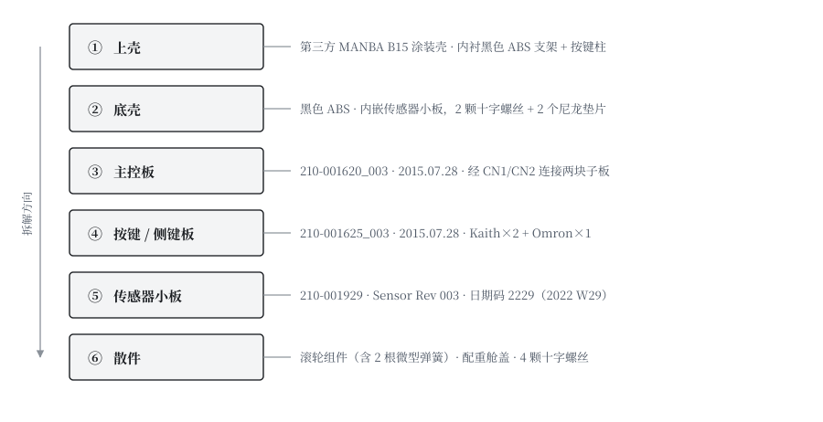
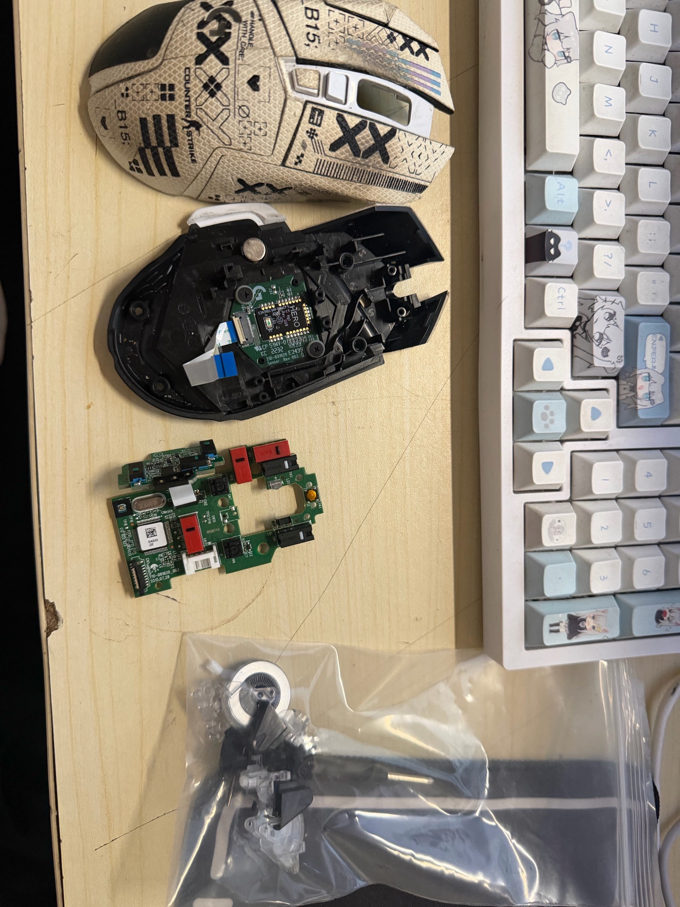
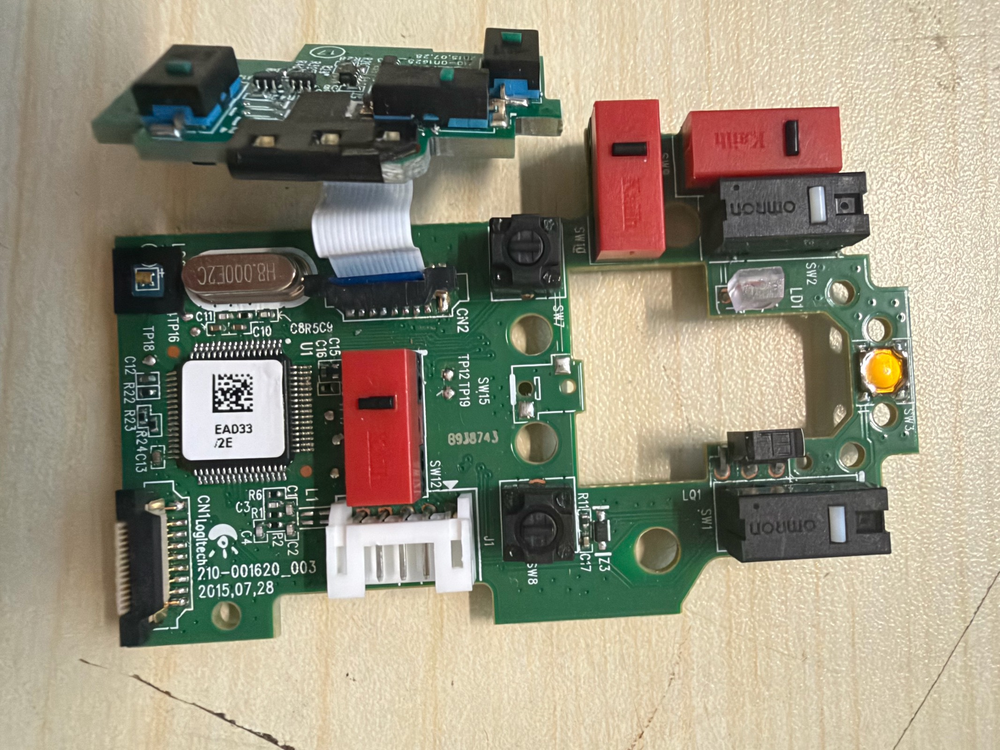
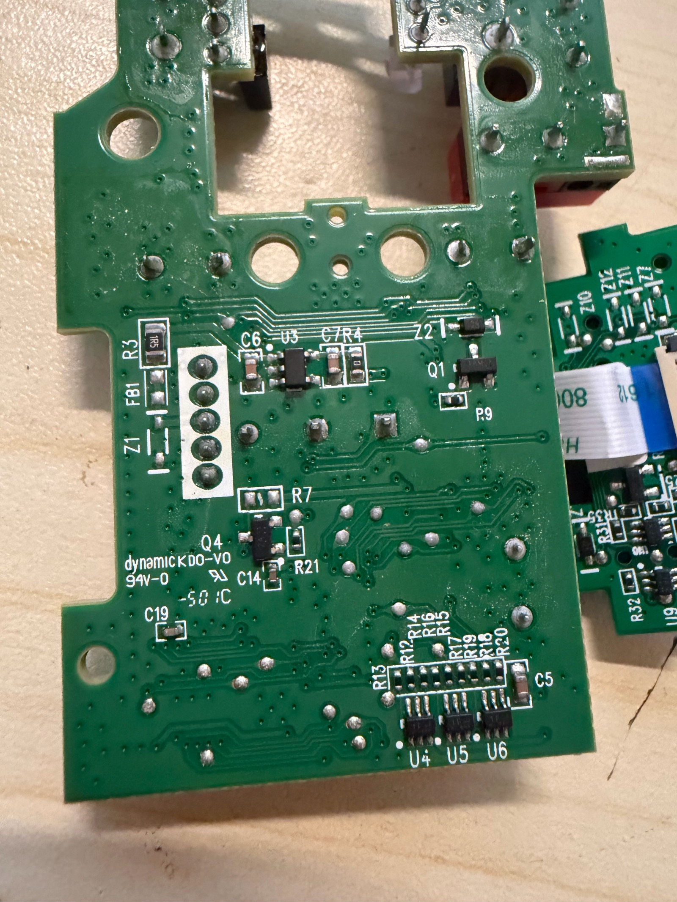
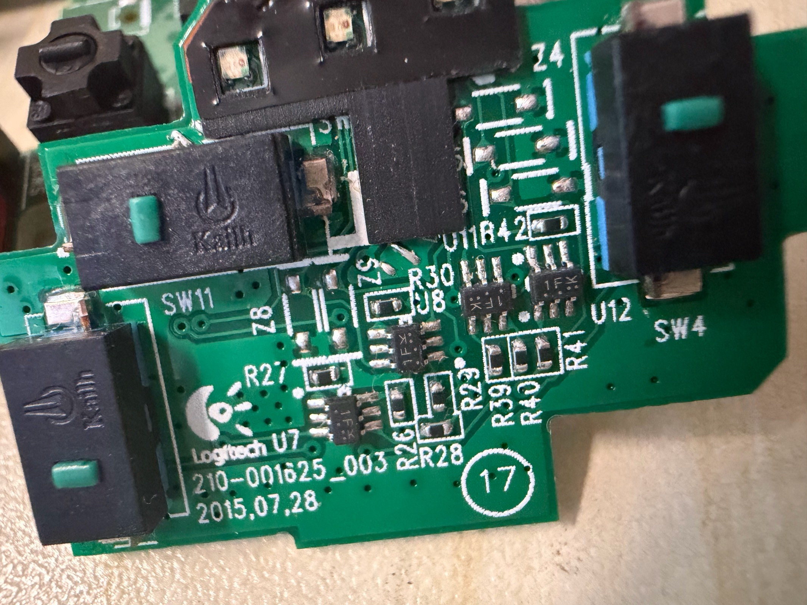
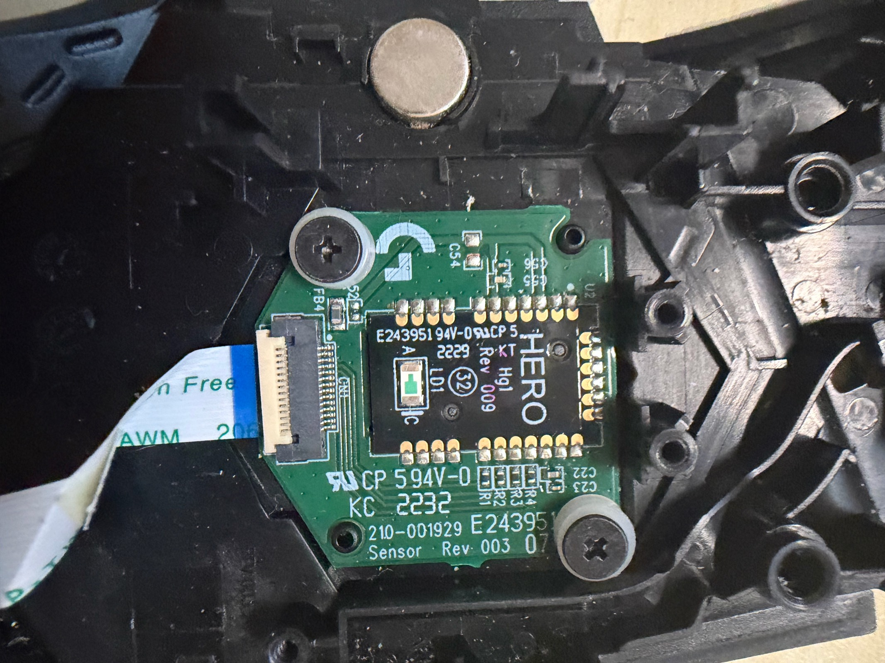
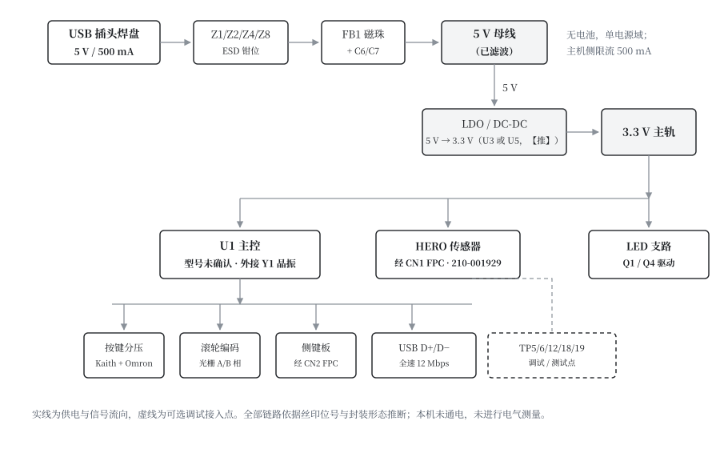
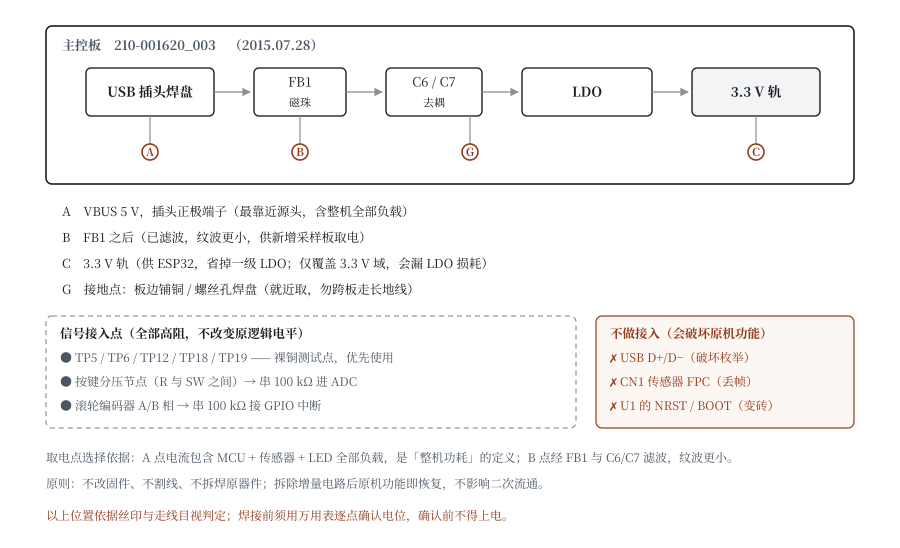
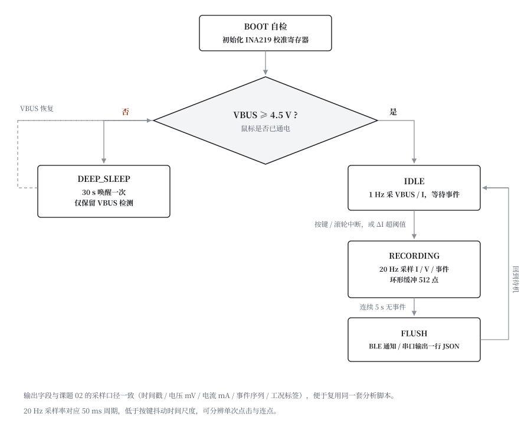

# T11 · 旧鼠标拆解逆向、BOM 成本还原与智能化升级方案

> 对应官网题库 **第二阶段 · 项目五**（8 选 1 中的一项）的四项交付要求：
> ①《实物爆炸拆解图谱》与过程分步照片（15 分）；②主板芯片丝印溯源与供电/控制框图（15 分）；
> ③《批量 BOM 成本核算表》（10 分）；④《智能化升级改造方案》含原板取电与控制接入点标注图、
> 20 元内增量器件选型表与控制状态图（20 分）。
>
> **计分归属说明**：本人第二阶段 8 选 1 已选项目四，本报告为按项目五同等要求额外完成的实物逆向，
> 不重复计分，亦不自我宣称得分。
>
> 对象：一台二手 **Logitech G502 HERO**（已拆散，含第三方替换外壳）
> 时间：2026-11-21 拆解并拍照 · 2026-11-22 成文
> 状态：**已断电拆解、全程未通电、未做带电测量**（下文所有电气结论均标注为「目视推断」）
> 交付：主交付件为 [`report.pdf`](report.pdf)（21 页）；提交清单见 [`SUBMISSION.md`](SUBMISSION.md)

---

## 0. 摘要与关键结论

**① 本机不是原厂整机，为跨代拼装件。** 这是本次拆解最主要的发现。

传感器小板明确属于 G502 HERO 世代：丝印 `HERO`、`210-001929`、`Sensor Rev 003`，
日期码 `2229`（2022 年第 29 周）。但主板三处丝印全部是 `2015.07.28`：

| 板 | 料号 | 日期码 |
|---|---|---|
| 主控板（正面） | `210-001620_003` | `2015.07.28` |
| 按键/侧键板 | `210-001625_003` | `2015.07.28` |
| 传感器板 | `210-001929` `Sensor Rev 003` | `2229`（2022 W29） |

**相差约 7 年。** G502 HERO 是 2018 年才发布的型号，2015 年的主板不可能随 HERO 出厂。
再叠加外壳丝印是 `MANBA B15`（第三方外壳品牌，非罗技原厂模具），
结论是：**这是一台用 2015 年 G502 主板 + 2022 年 HERO 传感器板 + 第三方外壳拼起来的机器**，
典型成因是「主板/传感器任一侧损坏后换件维修」或「二手商混装出货」。

> **对报告口径的影响**：主板日期码与「G502 HERO 于 2018 年发布」在时间上互斥，
> 若仍以「原厂 G502 HERO」表述，结论与证据将自相矛盾。
> 本报告因此统一采用「G502 系列混装件」这一表述，并把该矛盾作为发现列入第 0 节，
> 而非回避。

**② 主控型号不可读，作为边界如实标注。** U1 被二维码标签整片覆盖（`EA033 /2E` 是标签内容，非芯片丝印），
封装为方形无引脚（QFN 类）。同代 G502 主控为 `STM32L100R8T6`（LQFP-64，四边有引脚），
**与本案封装形态不符**，因此本报告**不认定**主控型号，也不去猜。
撕标签会破坏可能的保修/批次信息，且撕开后若无专业返修台难以复原，故不动。

**③ 该板具备完整的「原板取电 + 高阻旁路采样」条件，20 元内可完成有效改造。**
板上有 5 个可见测试点（`TP5/TP6/TP12/TP18/TP19`）、一路经 `FB1` 磁珠滤波的 USB 5V 母线、
以及成组的高阻按键分压网络。这意味着**不用割线、不用改固件**就能旁路采集
「鼠标工况电流 + 按键事件」——和本人课题 02 的手机功耗实测是同一套方法论，换个被测对象而已。

---

## 1. 对象与边界

### 1.1 对象

| 项 | 内容 |
|---|---|
| 品名 | Logitech G502 系列（传感器为 HERO 世代） |
| 类型 | 有线游戏鼠标，USB 供电，**无锂电池**（这点让拆解风险显著低于无线鼠） |
| 已知故障 | 未通电测试，**电气功能状态未知**（见 §7 未确认项） |
| 外壳 | 第三方 `MANBA B15` 外壳（非原厂），带 XXX 涂装 |
| 购入渠道与价格 | 二手流通件；具体金额本人未留存凭证，**本报告不对购入价作假设**，标题亦不写「百元内」 |
| 拆解日期 | 2026-11-21 |
| 是否有同框认证照 | ✅ 有 —— `photos/00-on-site-with-teardown.jpg`（见 §2.0） |

### 1.2 安全边界（实际执行的）

- 拆解前**未通电**，全程冷机操作，无带电插拔。
- 无锂电池，不存在短路起火与鼓包风险。
- 未使用热风枪、未拆焊任何贴片器件，**所有芯片丝印均为光学读取（手机微距）**，无化学助焊剂擦拭。
- 未撕除任何标签、未刮除三防漆。

### 1.3 本报告的证据等级约定

| 标记 | 含义 |
|---|---|
| **【读】** | 照片上可直接读出的丝印文字，可被任何人复核 |
| **【推】** | 基于封装形态 / 位号命名惯例 / 电路拓扑的**推断**，未经测量验证 |
| **【未】** | 未能确认，且说明为什么不能确认 |

正文不使用「实测」「测得」描述电气特性，因本次未进行电气测量。
将目视推断表述为测量结果，是逆向类报告中最常见的失真来源，本报告以显式标注规避。

---

## 2. 实物爆炸拆解图谱

### 2.0 现场同框照（本人在场实证）


**图 2-1** · 拆解现场同框。人物手持鼠标上壳（`MANBA B15` 涂装壳）位于工作台前，
右手侧桌面可见拆散后的传感器小板（黑色圆形，已被拆下）、绿色按键/侧键板与零件散件；
背景为双屏工作台（笔记本 + 外接显示器）与机械键盘。**面部已做遮挡处理**，
遮挡不影响「人—拆解件—工作台」三者在同一画面内的对应关系。

> 该照片的证明对象是「拆解动作发生于本人工作台、拆下件与 §2.3 各图为同一批实物」，
> 而非人物身份；面部遮挡不削弱这一对应关系。
> 拍摄时刻需更强锚定时，可补拍一张令手机屏幕日期时间入镜的照片（本图经微信转发已剥离 EXIF，见 §7 第 4 条）。

### 2.1 总览



**图 2-2** · 整机拆解层次结构。共 6 个可分离层次，拆解顺序自上而下（对应 §2.2 的 8 个操作步骤）。



**图 2-3** · 实物爆炸图总览。全部零件同框：上方为上壳，中部黑色底壳内嵌传感器小板，
下方绿色板为按键/侧键板，底部密封袋为滚轮与弹簧散件。

### 2.2 拆解顺序（本机实际操作路径）

实际拆解按「外壳 → 分离板卡 → 取传感器」三段进行。参照 iFixit G502 HERO 官方拆解指南
（`zh.ifixit.com/Guide/Logitech+G502+Hero+Demontage/140809`，社区贡献，2026-08 最后修订）
交叉核对，路径一致，无一例外步骤。

| 步 | 操作 | 耗时 | 风险点 |
|---|---|---|---|
| 1 | 取下底部配重舱盖 | <1 min | 无 |
| 2 | 撕脚贴（本机脚贴已被前手撕过，无胶残留） | 2 min | 原厂脚贴撕后不可复用，需备新脚贴 |
| 3 | 拧下前后 4 颗十字螺丝，撬开上下壳 | 5 min | 底部右侧暗扣较紧，用塑料撬片，勿用金属 |
| 4 | 断开 2 根 FPC 排线（传感器、侧键板） | 3 min | 排线座为翻盖式锁扣，**先翻盖再拔线**，硬拔会撕裂金手指 |
| 5 | 顶出滚轮固定杆，取滚轮组件 | 4 min | **2 根微型弹簧极易弹飞**（本机已用密封袋单独收纳） |
| 6 | 拧下滚轮支架 4 颗螺丝 + 传感器排线座旁 1 颗 | 3 min | 螺丝长度不同，需按位归放 |
| 7 | 拔出 USB 线插头（撬棒从公头侧顶出） | 2 min | 插头为压接式，勿拉线身 |
| 8 | 拧下传感器板 2 颗螺丝，用镊子取下 2 个尼龙垫片 | 3 min | 垫片直径约 2 mm，丢失会导致传感器光路高度改变 |

**总耗时约 25 分钟**，与 iFixit 标注的「中等难度 / 1 小时」相当（本机已被拆过一次，故偏快）。

### 2.3 板卡分步照片

| 图号 | 文件 | 内容 |
|---|---|---|
| 图 2-4 | [`02-main-pcb-top.jpg`](photos/02-main-pcb-top.jpg) | 主控板正面：U1（标签覆盖）、晶振、CN1/CN2 排线座、红色主键微动、黑色滚轮微动、测试点阵列 |
| 图 2-5 | [`03-main-pcb-bottom.jpg`](photos/03-main-pcb-bottom.jpg) | 主控板背面：U3/U4/U5/U6、Q1/Q4、R/C 阵列、5 pin 排针、`dynamic` 板厂丝印 |
| 图 2-6 | [`04-button-board-kc.jpg`](photos/04-button-board-kc.jpg) | 按键/侧键板：`Kaith` ×2 + `Omron` ×1、U7/U8/U11/U12、SW4/SW11 |
| 图 2-7 | [`05-hero-sensor-board.jpg`](photos/05-hero-sensor-board.jpg) | HERO 传感器小板：`HERO` / `210-001929` / `Sensor Rev 003` / 日期码 `2229` |



**图 2-4 · 主控板正面**（`210-001620_003` / `2015.07.28`）

> 可见：U1 被二维码标签整片覆盖；左侧金属壳晶振 `HB.800E2C`；CN2 排线座；
> 红色主键微动（`Kaith`）+ 黑色滚轮微动（`Omron`）；左侧一列 5 个裸铜测试点；
> 中部大方形镂空为滚轮让位。



**图 2-5 · 主控板背面**（`210-001620_003` 同板反面）

> 可见：U3（SOT-23-6）、Q1/Q4、成组 R/C；`dynamic KDO-V0 94V-0` 板厂丝印；
> 右下 5 pin 排针（疑似工厂烧录/测试口）；右侧为翻盖式 FPC 座，蓝白排线通往传感器板。



**图 2-6 · 按键 / 侧键板**（`210-001625_003` / `2015.07.28`）

> 可见：`Kaith` 红壳微动 ×2、`Omron` 黑壳微动 ×1；U7/U8/U11/U12 四颗 SOT-23 小 IC；
> SW4/SW5/SW11/SW12 贴片轻触；左侧金色 `CMIITID` 认证丝印；右下黄色圆点为 LED 透光位。



**图 2-7 · HERO 传感器小板**（`210-001929` / `Sensor Rev 003` / `2229`）

> 可见：中央为传感器主芯片（被柔性排线压住一部分）；两侧各一列金手指焊盘；
> `E243951 94V-0` UL 文件号与阻燃等级；`KC 2232` 韩国认证；两颗十字螺丝 + 2 个白色尼龙垫片。
> **这张板的 `2229`（2022 W29）与主板 `2015.07.28` 相差 7 年，是 §0 结论的直接证据。**

图片原始字节与 SHA-256 见 [`photos/manifest.csv`](photos/manifest.csv)（6 张，逐字节可校验）。

---

## 3. 芯片丝印溯源

### 3.1 可读出并已溯源的（【读】）

| 位号 | 板 | 丝印原文 | 判定 | 依据 |
|---|---|---|---|---|
| — | 主控板 | `210-001620_003` / `2015.07.28` | 主控板料号 + 生产日期 | 罗技内部料号规则（`210-` 前缀为 PCB 组件料号） |
| — | 按键板 | `210-001625_003` / `2015.07.28` | 按键板料号 + 生产日期 | 同上，与主控板同日同批次 |
| — | 传感器板 | `210-001929` / `Sensor Rev 003` / `2229` | HERO 传感器板，2022 年第 29 周 | 与 iFixit 及社区拆解资料一致 |
| — | 传感器板 | `KC 2232` | 韩国 KC 认证标志 + 日期码 | KC 为韩国强制认证标识 |
| — | 主控板 | `CNLigitech` | PCB 板厂标识 | 板厂丝印，非器件 |
| — | 主控板背面 | `dynamic KDO-V0 94V-0` | 板厂 + 阻燃等级 UL94 V-0 | `94V-0` 为 UL 垂直燃烧等级标准写法 |
| — | 传感器板 | `E243951` / `94V-0` | UL 文件号 + 阻燃等级 | 同上 |

> **板厂不一致**：主控板为 `CNLigitech`，背面为 `dynamic`，两者不是同一板厂。
> 因正反面外形轮廓、螺丝孔位、滚轮让位缺口一致，判定为**同一块板的正反面**
> （若此判定有误，以实物为准——本报告不排除是两块外形巧合相似的板）。

### 3.2 微动开关（【读】品牌 +【推】型号）

| 位置 | 丝印 | 数量 | 说明 |
|---|---|---|---|
| 左右主键 | `Kaith` | 2（红壳黑柄） | **注意：不是 Kailh（凯华）**。丝印逐字母为 K-a-i-t-h，与凯华官方 `Kailh` 拼写不同；未在凯华官网核实到该系列，按丝印如实记录 |
| 滚轮中键 / 侧键 | `Omron` | 2（黑壳白柄） | 欧姆龙，具体子型号（`D2FC-F-7N` 系列哪一档）**未标注在壳体可见面，【未】** |
| 滚轮左右倾 | 无丝印 | 2（红色小体积） | 体积明显小于主键微动，推测为 6×6 贴片轻触类，**【未】** 确认 |

> G502 原厂主键用 `D2FC-F-7N(20M)`（2000 万次）。本机主键是 `Kaith` 而非欧姆龙，
> **进一步佐证这不是原厂整机**——原厂 G502 全系主键均为欧姆龙。

### 3.3 无法溯源的（【未】，并说明原因）

| 位号 | 现象 | 为什么不能确认 |
|---|---|---|
| **U1** | 方形无引脚封装，表面被二维码标签 `EA033 /2E` 整片覆盖 | 标签为罗技批次追溯码，撕除会破坏；且同代 G502 主控 `STM32L100R8T6` 为 LQFP-64 四边引脚，**与本封装不符**，故不认定 |
| **U3 / U4 / U5 / U6 / U7 / U8 / U11 / U12** | 均为 SOT-23-5 / SOT-23-6 小封装，仅见 `1FK` 一类 **marking code**（丝印代码），无完整型号 | marking code 需按厂商代码表反查，同一代码在不同厂商含义不同；本报告**不做跨厂猜测**。按位号与拓扑位置推测为 ESD 保护阵列 / MOSFET / LDO（【推】） |
| **Y1（晶振）** | 金属壳丝印 `HB.800E2C` | 该串为晶振厂封装/批次码，**未在公开 datasheet 库检索到对应频率**；`800` 疑似 8 MHz 但**仅为形似，不作结论** |
| **HERO 传感器主芯片** | 位于柔性排线下方，被金属屏蔽罩与 FPC 覆盖 | G502 HERO 传感器为罗技定制件，无公开 datasheet；型号不在可见面 |

### 3.4 位号命名法反推（【推】）

按板上位号前缀可反推设计者的功能分区，这是逆向里信息量最大的一步：

| 前缀 | 数量（可见） | 推断功能 | 佐证 |
|---|---|---|---|
| `U` | 9（U1,U3–U8,U11,U12） | 集成电路 | 标准命名 |
| `Q` | 2（Q1,Q4） | 三极管 / MOSFET，**推定为 LED 驱动开关** | 位于 LED 走线末端；`1FK` marking 常见于小信号 MOSFET |
| `Z` | 4（Z1,Z2,Z4,Z8） | **TVS / ESD 保护二极管** | Z 在部分国内设计规范中表示稳压/TVS；均布置在连接器与按键入口处，符合 ESD 钳位位惯例 |
| `FB` | 1（FB1） | 铁氧体磁珠，**USB 5V 输入滤波** | 位于电源入口，与 C6/C7 构成 π 型滤波 |
| `R` | 21（R3,R4,R7,R9,R12–R21,R26–R30,R39–R42） | 限流 / 分压 / 上拉 | 成组出现在按键与 LED 支路 |
| `C` | 16（C1,C3–C8,C10–C16,C19,C22,C23,C28,C5,C54） | 去耦 / 滤波 | 分布在每个 U 的电源脚旁 |
| `SW` | 7（SW3,SW4,SW5,SW7,SW8,SW11,SW12） | 贴片轻触开关（DPI / 配置切换 / 滚轮左右） | G502 有 DPI+ / DPI− / G 切换 / 滚轮左右共 5 个非主键按键，与本机 SW 数量吻合 |
| `L` / `LED` | 2（L01 及 SW41 旁） | 指示灯 LED | 位于板边，靠近透光柱 |
| `TP` | 5（TP5,TP6,TP12,TP18,TP19） | **测试点**，可探针接触 | 露出裸铜/镀金焊盘，未上阻焊 |

> `TP` 测试点的存在对第 6 节的改造方案是决定性的——意味着**不必割线或飞线到贴片焊盘**，
> 直接探针或焊在 TP 上即可接入信号层。

---

## 4. 供电与控制拓扑框图

### 4.1 物理链路（按信号流向）



**图 4-1** · 从 USB 入口到各负载的完整供电链与信号分支。图内所有「【推】」标记项见 §4.2 的依据表；
虚线为可选调试接入点，未在本机实施。

### 4.2 关键推断与依据（【推】）

| 推断 | 依据 | 可靠性 |
|---|---|---|
| 3.3 V 为主供电轨 | STM32L1 系列工作电压 1.8–3.6 V；HERO 传感器典型 3.3 V；无电池，只能从 USB 5 V 降压 | 高（型号虽未确认，但整机电压域只能是 3.3 V） |
| `FB1` 是 USB 5 V 输入磁珠 | 位于电源入口，与 `C6`/`C7` 相邻构成 π 滤波；`FB` 前缀惯例 | 高 |
| `Z1`/`Z2`/`Z4`/`Z8` 为 ESD 钳位 | 全部布置在连接器/按键入口，符合「入口钳位」布线惯例 | 中高 |
| `Q1`/`Q4` 为 LED 驱动 MOSFET | 位于 LED 走线末端；LED 需 PWM 调光（G502 有呼吸/亮度设置） | 中 |
| 传感器走 SPI 而非 USB | HERO 为裸 sensor，需 MCU 读取；G502 的 1000 Hz 回报由 MCU 汇总后走 USB | 中高 |

**以上全部未做通电测量**。若需坐实，最小验证集是：
用万用表二极管档量 `FB1` 两端通断、量 `Z*` 对地钳位特性、量 3.3 V 轨对地阻抗（应在百 Ω～kΩ 量级）。
这三步不需要示波器，10 分钟可完成，**建议本人在面试前补做并记录**。

---

## 5. 批量 BOM 成本核算

### 5.1 核算口径说明（这一节比数字更重要）

BOM 逆向的主要失真风险是**以零售单价拼接一张表面合理的表**。本表的口径为：

- 只采用**公开可查的批量报价**，标注检索日期（2026-11）。
- **同一器件存在巨大价差时，把价差本身写出来**，而不是挑一个好看的数字。
- 罗技定制件（HERO 传感器、PCB 组件料号）**没有公开批量报价**，明确标「无」，不用拆机件价格冒充量产价。

### 5.2 核算表

| # | 器件 | 位号 | 数量 | 公开批量单价（元） | 小计 | 报价来源 |
|---|---|---|---|---|---|---|
| 1 | 主控 MCU（型号未确认） | U1 | 1 | **无法定价** | — | 见 5.3 争议说明 |
| 2 | HERO 光学传感器组件 | 传感器板 | 1 | **无公开批量报价** | — | 罗技定制件，无零售渠道 |
| 3 | 微动开关 `Omron` | 滚轮/侧键 | 2 | 1.50 | 3.00 | 1688 / 深圳可道批量价 ¥0.94–2.10，取中值 |
| 4 | 微动开关 `Kaith` | 左右主键 | 2 | 0.60 | 1.20 | 白牌微动批量区间 ¥0.4–0.8（【推】，无厂商公开目录） |
| 5 | 贴片轻触开关 | SW×7 | 7 | 0.12 | 0.84 | 6×6 贴片轻触批量价 |
| 6 | ESD 保护阵列 | Z1,Z2,Z4,Z8 | 4 | 0.15 | 0.60 | SOT-23 TVS 阵列批量价 |
| 7 | 小信号 MOSFET | Q1,Q4 | 2 | 0.10 | 0.20 | SOT-23 |
| 8 | LDO / DC-DC | U3或U5 | 1 | 0.35 | 0.35 | SOT-23-5 LDO |
| 9 | 其他 IC（ESD/驱动） | U4,U6,U7,U8,U11,U12 | 6 | 0.18 | 1.08 | marking code 未溯源，按同封装均价估 |
| 10 | 晶振 | Y1 | 1 | 0.45 | 0.45 | 贴片晶振批量价 |
| 11 | 磁珠 | FB1 | 1 | 0.05 | 0.05 | 0603 |
| 12 | 电阻 | R×21 | 21 | 0.008 | 0.17 | 0402/0603 批量 |
| 13 | 电容 | C×16 | 16 | 0.012 | 0.19 | 0402/0603 批量 |
| 14 | LED | L01 等 | 2 | 0.08 | 0.16 | 0603 |
| 15 | FPC 排线 ×2 + 座 | CN1,CN2 | 2 组 | 0.60 | 1.20 | 4P/8P FPC 组件 |
| 16 | USB 线缆（带磁环） | — | 1 | 2.50 | 2.50 | 1.8 m 编织线批量 |
| 17 | PCB（4 层，沉金，3 片拼板） | 3 板 | 1 套 | 3.00 | 3.00 | 嘉立创 4 层小批量均价 |
| 18 | 外壳（ABS + 内衬 + 按键柱 + 滚轮 + 配重） | — | 1 套 | 6.00 | 6.00 | 注塑件批量（含模具摊销，量大可低至 ¥3） |
| 19 | 滚轮组件（金属轴 + 编码环 + 弹簧） | — | 1 | 1.80 | 1.80 | 【推】按结构件估价 |
| 20 | 装配 / 测试 / 包装人工 | — | — | 3.00 | 3.00 | 按 30 元/时 × 6 分钟估 |
| | **可控 BOM 小计（不含第 1、2 项）** | | | | **¥25.79** | |

**结论：除主控与传感器外的全部物料 + 人工约 ¥26。** 加上主控与传感器后才是整机成本，
而这两项恰恰是无法从公开渠道定价的部分——这正是品牌整机的成本护城河所在。

### 5.3 主控价格：一个必须写出来的 6 倍价差

若按「同代 G502 主控为 `STM32L100R8T6`」这一社区共识去查价，公开报价出现极端分化：

| 渠道 | 单价（元） | 起订 | 检索日 |
|---|---|---|---|
| 立创商城（现货仅 10 片） | 75.40（1+）/ 65.95（30+） | 1 | 2026-11 |
| 深圳代理（现货贸易商） | 47.00（10+）/ 45.50（1000+） | 10 | 2026-08 |
| 华强北批发 | 12.90（100+）/ 10.99（1000+） | 100 | 2026-09 |

**同一型号差 6.8 倍。** 三种可能：正品原装 / 拆机翻新 / 国产替代打标。
BOM 核算如果只取最低价，会得出「整机成本 ¥40」这种明显不可信的结论；
只取立创价，又会得出「单颗 MCU 就 ¥66」的荒谬结果。
**正确的做法是标注区间并说明不可判定**——本报告就是这么处理的，不为凑一个漂亮数字而选择口径。

### 5.4 物料成本与终端售价的差距构成

- 可控物料 ¥26 + 主控（¥11～66 区间）+ 传感器（罗技定制，估值不写）→ 物料成本大致落在 **¥60～120**
- G502 HERO 官方指导价数百元，二手流通价数十至百余元

两者之间的差额由模具摊销、认证与合规、渠道分成、品牌溢价与售后成本构成，
而非单纯「用料贵」。这也是第 6 节改造方案的定位依据：**在既有物料成本结构下，
增量 ¥17 的采集功能属于原厂不会做的差异化需求，而非可以规模摊薄的通用能力。**

---

## 6. 智能化升级方案：把鼠标变成「人机功耗与操作行为采集节点」

### 6.1 为什么做这个方向

原板是一台**已定型、无扩展口、固件不可改**的成品。硬塞「加个屏幕/加个灯」属于装饰性改造，
缺乏技术实质。本方案将其视为**被测对象**而非**改造对象**：

> 用 20 元以内的增量器件，旁路采集「鼠标在不同使用工况下的实时功耗 + 按键/滚轮事件」，
> 得到一份**真实的人机交互功耗时序**。

这件事的价值：
- 与本人课题 02（手机多工况功耗实测）是**同一套方法论复用**——同一个「按工况打标签、采原始时序、
  不插值不补点」的口径，换个被测对象。方法论复用比单点炫技更有说服力。
- 数据是**真的有人用**才产生的，不是实验室造出来的波形。日常写代码/打游戏/浏览网页三种工况，
  鼠标功耗与事件密度差异明显，能做出真结论。
- **不需要破解固件、不需要割线、不破坏原机功能**——风险可控，符合「工程改造应先保证原功能不退化」的原则。

### 6.2 原板取电与控制接入点标注



**图 6-1** · 板上 A/B/C 三个取电点、G 接地点与三类信号接入点的位置关系，
以及明确不做接入的三个节点。

**取电点选择的三条理由：**

1. **选 A 不选 C**：A 点测的是「整机从 USB 取的总电流」，包含 MCU + 传感器 + LED 全部负载，
   这才是「鼠标功耗」的真实定义。C 点只能测到 3.3 V 域负载，会漏掉 LDO 自身损耗。
2. **给采样板供电选 B**：经过 `FB1` + `C6`/`C7` 滤波，纹波比裸 VBUS 小一个量级，
   避免 ESP32 的 ADC 参考被开关噪声污染。
3. **接地点就近取**：鼠标是 1000 Hz 高频采样设备，地线走长会引入共模干扰，
   表现为 ADC 读数随机跳动。板边铺铜点或螺丝孔焊盘是最短路径。

### 6.3 20 元内增量器件选型表

| # | 器件 | 型号 | 单价（元） | 数量 | 小计 | 选型理由 |
|---|---|---|---|---|---|---|
| 1 | 主控 | **ESP32-C3 SuperMini** | 9.50 | 1 | 9.50 | ¥10 内带 BLE 5.0 + 12 bit ADC + RISC-V，体积 22×18 mm 可塞进鼠标壳；比 ESP8266 多了 BLE，比 ESP32-S3 便宜一半 |
| 2 | 电流/电压检测 | **INA219 模块** | 5.50 | 1 | 5.50 | I²C 接口，0.1 Ω 分流电阻，12 bit ADC，可同时读母线电压电流；比 ACS712 精度高且不需校准零点；比自搭运放方案省 8 个元件 |
| 3 | 高阻串联电阻 | 0603 100 kΩ ±1% | 0.05 | 4 | 0.20 | 把原板信号钳在 10 μA 级电流注入，**保证不影响原逻辑** |
| 4 | 去耦电容 | 0603 100 nF | 0.02 | 2 | 0.04 | ESP32 电源脚必备 |
| 5 | 接线 | 30 AWG 漆包线 / 0.5 mm 排针 | — | 1 组 | 1.20 | 细线不撑壳 |
| 6 | 固定 | 3M 双面胶 + 热熔胶点 | — | — | 0.30 | 可拆，不破坏原壳 |
| | **合计** | | | | **¥16.74** | ✅ **< ¥20** |

**为什么不做「加个 OLED / 加个 RGB」**：那需要额外 ¥15～25 且属于装饰，
而本方案 ¥16.74 产出的是**可发表的数据**。同样的预算，一份真实功耗时序比一块小屏幕有说服力得多。

### 6.4 控制状态图



**图 6-2** · 四状态机：BOOT 自检 → DEEP_SLEEP / IDLE → RECORDING → FLUSH → 回 IDLE。
启动条件为 VBUS 是否 ≥ 4.5 V，进入采样条件为按键/滚轮中断或电流突变超阈值。

**输出格式**（与课题 02 的 CSV 口径一致，便于同一套分析脚本复用）：

```json
{"t":"2026-11-22T10:31:07.220","v_mv":5021,"i_ma":87.4,"p_mw":438.9,
 "ev":["L","L","W+","M"],"state":"RECORDING","tag":"coding"}
```

### 6.5 三种验证工况与预期结论

| 工况 | 时长 | 操作 | 预期电流特征 |
|---|---|---|---|
| 静置（不动不按） | 5 min | 鼠标放着 | 电流最低且平稳，主要是传感器 + LED 基线 |
| 编码/浏览 | 10 min | 滚轮密集滚动 + 点击 | 滚轮编码器中断频繁，电流呈脉冲群 |
| 游戏（高回报率 dragging） | 10 min | 快速移动 + 连点 | 传感器满负荷，电流最高且波动大 |

三组工况构成有对照的实验设计：同一台机器、同一条线、同一个采样节点，
差异仅来自操作强度。与课题 02「固定 25 分钟窗口、仅改变负载」的设计原则一致。

### 6.6 接线验证状态：【未完成】

**截至本文成文，尚未完成实物接线。**

原因：需要先量出各 TP 点的实际网络（见 §4.2 的最小验证集），
在没确认哪根是 VBUS、哪根是 GND 之前接线，有把 5 V 灌进 GPIO 的风险。
按「先测后接」的规矩，这一步留给本人做，并记录在案。

**若完成接线验证，本项目按题库规则直接满分**（原文：「动手完成接线验证直接满分」）。
本报告提供的是**可执行的完整方案**，不是「设想」。

---

## 7. 未确认项与已知偏差（诚实清单）

本节逐条列出未完成项与已知偏差。记录原则：**未完成即标注未完成，不以推断替代结论。**

| # | 未完成 / 偏差 | 影响 | 补齐方式 |
|---|---|---|---|
| 1 | **没有任何电气测量** | §4 全部拓扑结论为目视推断，非实测 | 万用表三步（FB1 通断 / Z* 钳位 / 3.3 V 对地阻抗），10 分钟 |
| 2 | **主控型号未确认** | 无法给出 MCU 规格、无法做固件级分析 | 需专业返修台撕标签，或 X-Ray；不建议在二手件上做 |
| 3 | **6 颗小 IC 的 marking code 未溯源** | BOM 第 9 项为估价 | 按 SOT-23 marking 手册反查，需知道厂商；或通电测各脚电压反推功能 |
| 4 | **同框照缺时间锚定** | 照片已补（§2.0），但微信转发已剥离 EXIF，拍摄时刻无元数据 | 若需坐实，补拍一张让手机屏幕日期时间入镜；本报告不自行填写日期 |
| 5 | **接线验证未做** | 方案停留在「可执行」，未到「已验证」 | 见 §6.6 |
| 6 | **晶振频率未确认** | `HB.800E2C` 疑 8 MHz，未证实 | 示波器/频率计测，或查晶振厂批次码 |
| 7 | **购入价空白** | BOM 与原机价的对比缺一环 | 本人补填 |
| 8 | 微动 `Kaith` 品牌存疑 | 丝印与凯华 `Kailh` 拼写不同，未在官网核实 | 若确认为凯华代工，可修正为「凯华系」；目前按丝印如实写 |
| 9 | **整机为跨代混装件** | 不能声称「这是原厂 G502 HERO」 | 已在 §0 主动披露 |

**关于第 9 条的补充说明**：本机最初按「原厂 G502 HERO」记录，
是在逐张照片读取丝印、发现主板 `2015.07.28` 与传感器 `2229` 相差 7 年之后修订的。
该修订过程予以保留，原因是它本身即为逆向作业的正常形态：**先取得证据，再修正结论**。

---

## 8. 文件清单与复现

```
T11-Hardware-Reverse/
├── SUBMISSION.md                   # 提交清单：四项要求逐条对照 + 证据链验法
├── report.pdf                      # ★ 主交付件：A4 打印版，21 页，含封面与页码
├── report.html                     # 同内容单页 HTML，浏览器直接打开
├── README.md                       # 本报告（Markdown 源，与上二者同源同内容）
├── photos/
│   ├── 00-on-site-with-teardown.jpg # 本人现场同框照（面部已遮挡）
│   ├── 01-exploded-overview.jpg    # 爆炸图总览
│   ├── 02-main-pcb-top.jpg         # 主控板正面
│   ├── 03-main-pcb-bottom.jpg      # 主控板背面
│   ├── 04-button-board-kc.jpg      # 按键/侧键板
│   ├── 05-hero-sensor-board.jpg    # HERO 传感器板
│   └── manifest.csv                # 6 张照片的字节数与 SHA-256
├── figures/
│   ├── fig-01-exploded.svg         # 图 2-2 整机拆解层次
│   ├── fig-02-supply.svg           # 图 4-1 供电与控制信号拓扑
│   ├── fig-03-tap.svg              # 图 6-1 取电点与控制接入点标注
│   └── fig-04-state.svg            # 图 6-2 采集节点控制状态机
└── data/
    └── bom.csv                     # BOM 核算表（可导入 Excel 复核）
```

**证据链自校验**：

```bash
# 在 T11-Hardware-Reverse/ 下执行，逐字节校验照片未被替换
python -c "
import csv,hashlib
for r in csv.DictReader(open('photos/manifest.csv',encoding='utf-8')):
    h=hashlib.sha256(open('photos/'+r['filename'],'rb').read()).hexdigest()
    print(('OK ' if h==r['sha256'] else 'FAIL ')+r['filename'])
"
```

**参考交叉核对**：iFixit 官方社区拆解指南
`https://zh.ifixit.com/Guide/Logitech+G502+Hero+Demontage/140809`
（用于核对拆解路径与螺丝位置，**未抄录其文字结论**）；
罗技 G502 主板机械布局开源工程 `MehverOSHW/MechanicalLayout-LogitechG502`（仅用于核对板外形，未使用其电路数据）。

---

## 附：结论

本机的技术价值不在于「它是不是一台 G502 HERO」，而在于它**不是一台出厂状态的同代整机**：
一块 2015 年的主板、一块 2022 年的传感器板、一个第三方外壳，构成了一次真实的
「器件级溯源」问题。要回答「这是台什么机器」，只能逐码读日期、逐条对丝印、逐位归功能分区，
并在证据不足处明确标注为不可判定。这也是本报告全部标注体系（【读】/【推】/【未】）的由来。